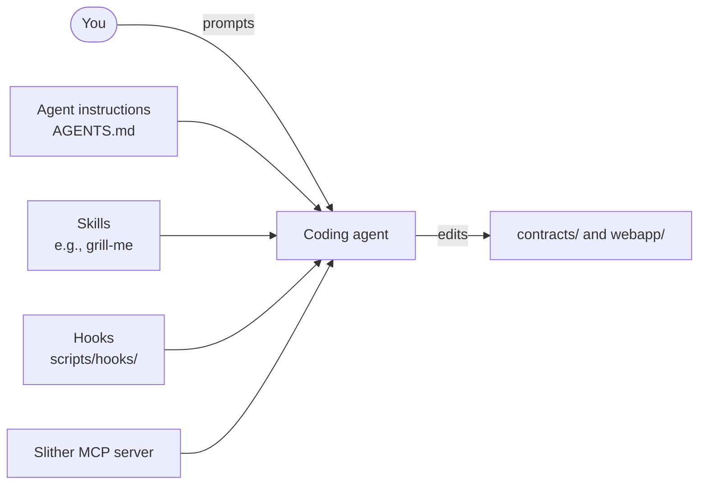
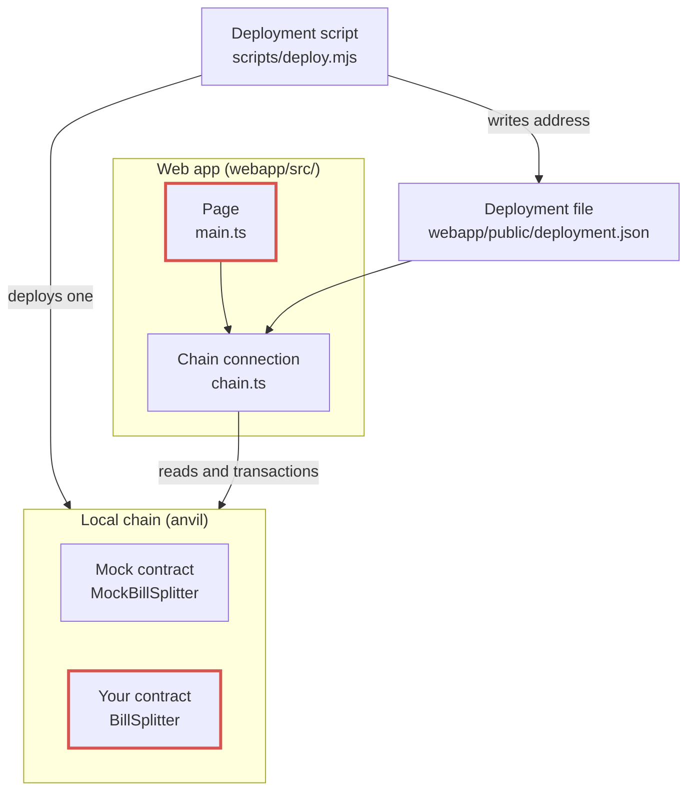

# How the system fits together

This document describes the pieces of the practical and how they connect. The worksheet is [README.md](../README.md).

**The coding agent.** You send it prompts, and it edits the code. Four things can shape its behaviour. The agent instructions are in the repository. The other three are optional, and [AGENT_SETUP.md](AGENT_SETUP.md) says how to add them.

- **Agent instructions:** rules the agent reads at the start of every session.
- **Skills, e.g., the interview skill:** when you ask, the agent questions you about what the system should do.
- **Hooks:** two scripts that run around each edit. One script blocks edits to the locked files, a list that you can extend, and reports any other change, removal or move of them; the other script compiles the contracts after a Solidity edit and sends any errors back to the agent.
- **Slither MCP server:** a code analysis tool that the agent can query about the contract. [AGENT_SETUP.md](AGENT_SETUP.md) gives its configuration.

**The app.** The web app runs in your browser; the local chain runs on your machine.

- **Deployment script:** `node scripts/deploy.mjs mock` deploys the mock, and `node scripts/deploy.mjs contract` deploys yours. Either way it writes the address to the deployment file, which tells the web app which contract to use.
- **Web app:** the page reads requests from the contract and sends transactions to it, as `docs/SPEC_FRONTEND.md` describes. Reads and transactions go through the chain connection, which uses *viem*, a TypeScript library for talking to Ethereum nodes, and signs as the test accounts. Reading data is free; changing data needs a signed transaction.
- **Contracts:** the *mock* is a stand-in contract: it returns fixed data and stores nothing, so the web page can run before your own contract is ready. `BillSplitter.sol` contains no logic of its own: it joins `Requests.sol`, `Payments.sol` and `Withdrawals.sol` into the one contract that is deployed. The mock and `BillSplitter` both implement the same *interface*, `contracts/src/interfaces/IBillSplitter.sol`, which lists the contract's functions, their arguments and its errors, but not their code. That is why the web app cannot tell them apart.

The boxes with a red border are partly written: you and your agent complete them. The web app never imports Solidity code: it uses the *ABI* (Application Binary Interface) in `webapp/src/abi.ts`, a JSON description of the contract's interface, to encode each call and decode the result.

**A transaction, step by step.** Creating a request is a *write*: a call that changes the contract's data, so it needs a transaction. A write goes through these steps:

1. viem builds a transaction and signs it with the private key of the *acting account*, the account that the user chose to act as. `webapp/src/chain.ts` holds these test keys and the connection to the local chain.
2. The node includes the transaction in a block.
3. The page waits for the *receipt*, the node's record of the result. If the contract rejected the call, it *reverted*: the call changed nothing on the chain. The contract names the reason with a *custom error*, such as `BillSplitter__InvalidAmount`. The name comes back through the ABI.

The web app signs transactions itself only because this is a local exercise with public test keys. In a real app, a wallet holds the private key and signs: the web app never sees the key.
